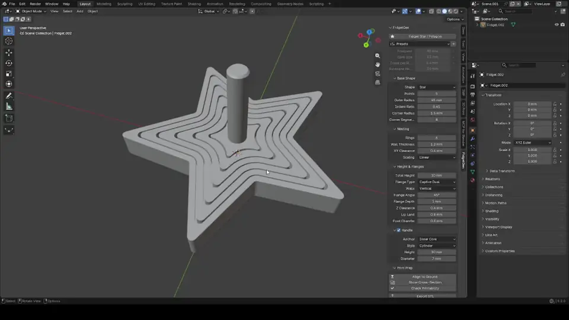

# PolyFidget

**PolyFidget** is a Blender 5.2 extension for designing print-in-place nested fidgets: stars, polygons and wavy shapes made of rings that slide inside each other. They print as one piece and come off the build plate already moving.

*Click the animation for the full-resolution video.*

## Features

- **Shapes:** stars, regular polygons and fluted (wavy) outlines, with settings for point count, size, indent and corner rounding.
- **Nested rings:** every ring is offset by a constant distance, so walls and clearances stay the same width all the way around. Wall thickness can be the same for every ring or grow toward the outside.
- **Flanges:** chamfered lips that keep the rings captive. Choose from:
  - *Telescopic down*: rings drop into a cone.
  - *Telescopic up*: rings rise into a tower.
  - *Captive dual*: rings slide a little up and down but stay level.
- **Walls:** vertical, or slanted at a set angle.
- **Handles:** a cylinder, knurled grip or mushroom cap on the centre core, or a thicker, taller outer frame to hold.
- **Live editing:** settings are stored on the object, and the mesh rebuilds as you change them.
- **Print prep:**
  - Presets for 0.4 mm and 0.6 mm nozzles and for tight or loose fits. You can save, rename and delete your own.
  - Tools to sit the model on the ground, preview a cross-section and check the mesh is printable.
  - STL export at 1 unit = 1 mm.

## Installation

1. Download `poly_fidget-x.y.z.zip` from the [latest release](https://github.com/stb1Cluny/PolyFidget/releases/latest). Don't unzip it.
2. In Blender 5.2, open **Edit > Preferences > Get Extensions**, click the **⌄** menu at the top right, choose **Install from Disk…**, and pick the zip.

To use it, press **Shift+A > Mesh > Fidget Star / Polygon** in the 3D Viewport, then adjust the settings in the **PolyFidget** tab of the sidebar (N).

## Project status

This is an early version. Here is where it stands:

- **Nothing has been test-printed yet.** Every mesh is checked to be watertight and every clearance is correct on paper, but no physical print has confirmed that the parts come apart and move. Expect to tune clearance for your printer and filament.
- It is only tested with Blender 5.2 on Windows.
- Inner rings keep the full corner radius at their tips, so the gap at star points is wider than the clearance you set. This is intentional: it keeps the tips printable.
- Some settings combinations don't fit together. The add-on then reports the problem (for example, "Too many rings: at most 7 fit") instead of building a broken mesh.
- Settings names and defaults may change between versions.

Bug reports and print results are very welcome.

## Credits

- Designed by stb1Cluny and written with [Claude](https://claude.com/claude-code) (Anthropic's Claude Code).
- During development, the add-on was tested in a live Blender session through [mcp-for-blender](https://github.com/ahujasid/mcp-for-blender) by ahujasid. It's a community plugin that lets an LLM drive Blender.

## License

GPL-3.0-or-later. That is the license declared in `poly_fidget/blender_manifest.toml`, as Blender add-ons require.
